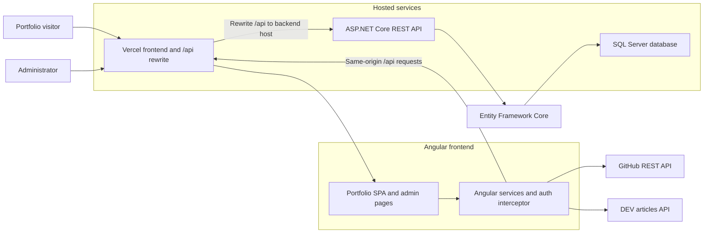
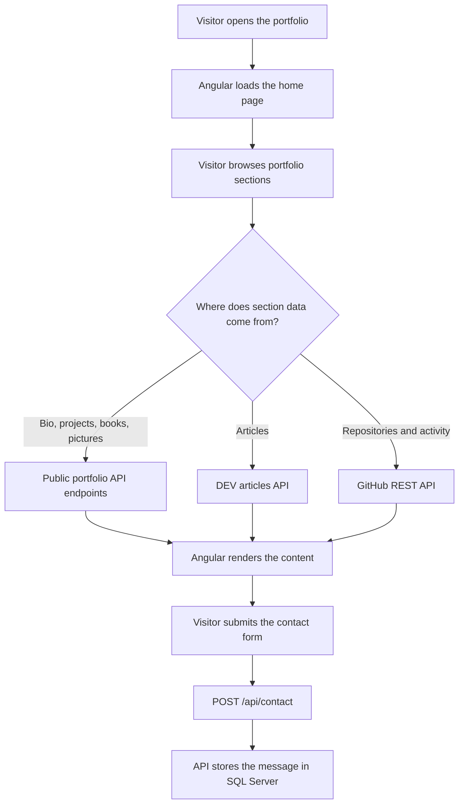
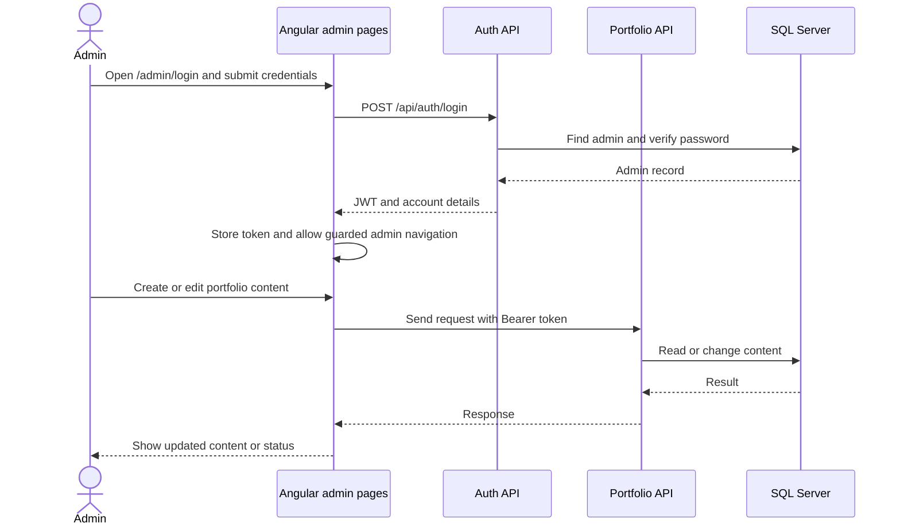
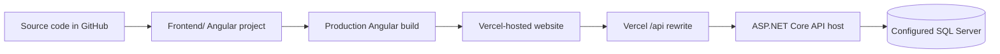

# Muhammad Zain Ul Abideen — Portfolio

Personal portfolio website and content-management API.

| | |
|---|---|
| **Live website** | [mzainulabideen.vercel.app](https://mzainulabideen.vercel.app/) |
| **Source repository** | [github.com/mzainulabideendev/mzainulabideendev_portfolio](https://github.com/mzainulabideendev/mzainulabideendev_portfolio) |

## Website screenshot


The screenshot is a mobile-sized capture of the live website.

## Contents

- [Overview](#overview)
- [Features](#features)
- [Technology stack](#technology-stack)
- [Architecture](#architecture)
- [Application workflows](#application-workflows)
- [Repository layout](#repository-layout)
- [Getting started](#getting-started)
- [API overview](#api-overview)
- [Deployment](#deployment)
- [Security notes](#security-notes)
- [Documentation](#documentation)

## Overview

The project is a full-stack portfolio with an Angular single-page application and an ASP.NET Core REST API. Visitors can explore the portfolio and send a message; an authenticated administrator can update portfolio content through protected pages.

The portfolio also loads blog posts from DEV and public repository information from GitHub. Those integrations are separate from the portfolio API.

## Features

### Public website

- Animated landing page, biography, projects, and career timeline.
- Blog articles, certifications, books, and image gallery.
- GitHub repositories and public contribution information.
- Contact form with submission to the API.
- Responsive navigation, theme support, scroll progress, loading indicators, and notifications.

### Admin pages

- JWT-based administrator sign-in.
- Create, edit, and remove projects, books, and gallery pictures.
- Update biography content.
- Review, mark as read, and delete contact messages.
- Guarded admin routes and an HTTP interceptor for authenticated API requests.

## Technology stack

| Area | Technologies |
|---|---|
| Frontend | Angular 17, TypeScript 5.4, SCSS, RxJS |
| Animation and graphics | GSAP, Three.js |
| Backend | ASP.NET Core (`net10.0`), C# |
| Data access | Entity Framework Core, SQL Server |
| Authentication | JWT bearer tokens |
| Frontend hosting | Vercel |
| External data | GitHub REST API, DEV API |

## Architecture



In production, the frontend uses `/api` as its API base URL. The Vercel rewrite in [Frontend/vercel.json](Frontend/vercel.json) forwards those requests to the configured API host. The local development proxy is configured separately in [Frontend/proxy.conf.json](Frontend/proxy.conf.json).

## Application workflows

### Visitor browsing and contact



### Administrator content management



### Build and hosting flow



The Angular production build is configured in `Frontend/vercel.json`. The API is deployed separately; its database connection string and administrator credentials must be configured on the API host.

## Repository layout

```text
.
├── Backend/
│   ├── Controllers/       # Authentication and portfolio API endpoints
│   ├── Data/              # EF Core database context and admin seeding
│   ├── DTOs/              # API request and response models
│   ├── Models/            # Database entities
│   ├── Services/          # Password hashing and JWT services
│   └── portfilo.csproj
├── Frontend/
│   ├── src/app/core/      # Models, guards, interceptors, and API services
│   ├── src/app/features/  # Public pages and admin features
│   ├── src/app/shared/    # Shared components, animations, and directives
│   ├── src/environments/  # Development and production API settings
│   └── vercel.json        # Frontend build and API rewrites
├── docs/images/           # Documentation images
└── README.md
```

## Getting started

### Prerequisites

- Node.js and npm compatible with Angular 17.
- .NET 10 SDK.
- A SQL Server database for running the API locally.

### Run the frontend

```powershell
Set-Location Frontend
npm ci
npm start
```

The Angular development server serves the site at `http://localhost:4200`. Its `/api` proxy target is set in `Frontend/proxy.conf.json`; change that target to your local API address if you want to develop against the local backend.

### Configure and run the backend

From the repository root, initialize .NET user secrets and set values for your local database and administrator account. For example:

```powershell
dotnet user-secrets init --project .\Backend\portfilo.csproj
dotnet user-secrets set "ConnectionStrings:DefaultConnection" "Server=(localdb)\MSSQLLocalDB;Database=portfoliodb;Trusted_Connection=True;TrustServerCertificate=True;" --project .\Backend\portfilo.csproj
dotnet user-secrets set "Jwt:Key" "replace-with-a-random-secret-at-least-32-characters" --project .\Backend\portfilo.csproj
dotnet user-secrets set "Jwt:Issuer" "PortfolioAPI" --project .\Backend\portfilo.csproj
dotnet user-secrets set "Jwt:Audience" "PortfolioClient" --project .\Backend\portfilo.csproj
dotnet user-secrets set "DefaultAdmin:Username" "your-admin-username" --project .\Backend\portfilo.csproj
dotnet user-secrets set "DefaultAdmin:Email" "you@example.com" --project .\Backend\portfilo.csproj
dotnet user-secrets set "DefaultAdmin:Password" "replace-with-a-strong-password" --project .\Backend\portfilo.csproj
```

The repository does not currently include EF Core migration files. Create the initial migration once before the first local API run; the project already references the EF Core tools package. Install a compatible `dotnet-ef` command-line tool if it is not already available:

```powershell
dotnet tool install --global dotnet-ef --version 9.0.0
dotnet ef migrations add InitialCreate --project .\Backend\portfilo.csproj --startup-project .\Backend\portfilo.csproj
dotnet ef database update --project .\Backend\portfilo.csproj
dotnet run --project .\Backend\portfilo.csproj
```

The checked-in launch settings use `http://localhost:5051` for the HTTP profile and `https://localhost:7297` for the HTTPS profile. The API serves Swagger UI at its root URL.

## API overview

All API routes are under `/api`. Read endpoints listed as public do not require a JWT; content-management endpoints require administrator authentication.

| Resource | Public routes | Administrator routes |
|---|---|---|
| Authentication | `POST /api/auth/login` | — |
| Biography | `GET /api/bio` | `POST`, `PUT /api/bio` |
| Projects | `GET /api/projects`, `GET /api/projects/{id}` | `POST`, `PUT`, `DELETE /api/projects/{id}` |
| Books | `GET /api/books`, `GET /api/books/{id}` | `POST`, `PUT`, `DELETE /api/books/{id}` |
| Pictures | `GET /api/pictures`, `GET /api/pictures/{id}` | `POST`, `PUT`, `DELETE /api/pictures/{id}` |
| Contact | `POST /api/contact` | `GET /api/contact`, `GET /api/contact/{id}`, `PUT /api/contact/{id}/read`, `DELETE /api/contact/{id}` |

For endpoint details and example requests, see [Backend/README.md](Backend/README.md) and [Backend/api-tests.http](Backend/api-tests.http).

## Deployment

### Frontend

The Vercel configuration is in `Frontend/vercel.json`:

- Build command: `npx ng build --configuration production`
- Output directory: `dist/portfolio-ui/browser`
- SPA fallback: unknown routes serve `index.html`.
- API requests under `/api/:path*` are forwarded to the configured backend host.

Deploy with `Frontend/` as the Vercel project root, and confirm the API rewrite target is the correct, reachable production API URL.

### Backend

Deploy `Backend/portfilo.csproj` to an ASP.NET Core host with access to SQL Server. Configure the database connection string, JWT key, issuer, audience, and initial admin credentials as host-provided environment variables or secrets. Do not rely on local user secrets in production.

## Security notes

- Never commit real connection strings, JWT signing keys, or administrator passwords.
- Use .NET user secrets for local development and the hosting provider's secret manager in production.
- Require HTTPS for the production API and update the Vercel rewrite target to its HTTPS URL when available.
- The API seeds the first administrator from configured `DefaultAdmin` values; set strong, unique credentials before first deployment.

## Documentation

- [Frontend guide](Frontend/README.md) — UI features, structure, and frontend notes.
- [Backend guide](Backend/README.md) — API endpoints and setup.
- [Backend security guide](Backend/SECURITY.md) — authentication and configuration guidance.
- [Backend security checklist](Backend/SECURITY_CHECKLIST.md) — deployment security checks.
- [Swagger guide](Backend/SWAGGER_GUIDE.md) — API documentation and testing.

## License

See [Frontend/LICENSE](Frontend/LICENSE).
